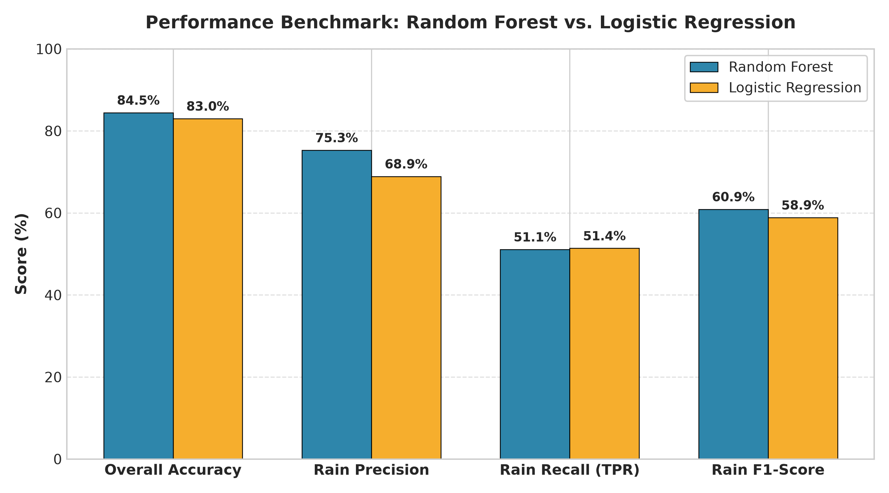
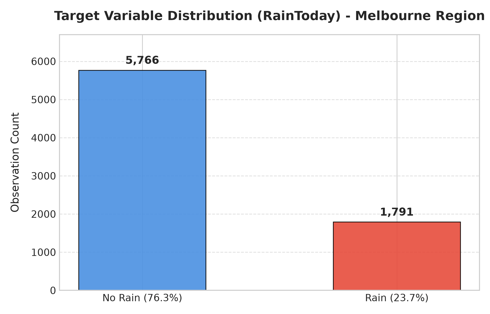
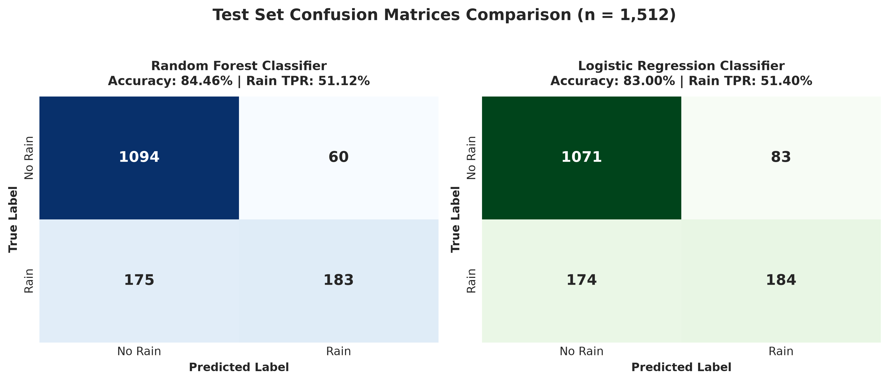
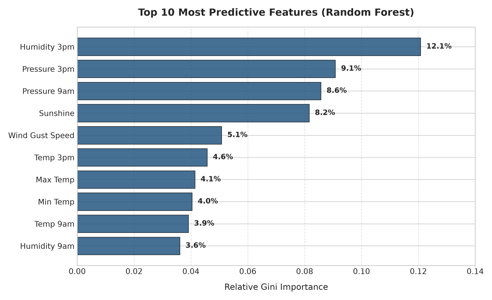
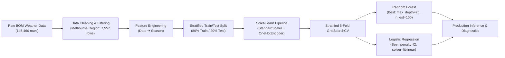

<div align="center">

# 🌧️ Rainfall Prediction Classifier
### Meteorological Machine Learning Benchmark for the Greater Melbourne Region
**Case Study: WeatherTech Inc. Predictive Analytics**

[](https://www.python.org/)
[](https://scikit-learn.org/)
[](https://opensource.org/licenses/MIT)
[]()
[](https://pep8.org/)

</div>

---

## 📌 Executive Summary

Accurate next-day rainfall forecasting is critical for agriculture, water resource allocation, event planning, and aviation safety. This repository presents an end-to-end, production-ready machine learning framework developed for **WeatherTech Inc.** to predict daily precipitation across the greater Melbourne metropolitan region (*Melbourne, Melbourne Airport, and Watsonia*).

Utilizing historical daily weather observations from the **Australian Bureau of Meteorology (BOM)**, we formulate the forecasting challenge as a binary classification task (`RainToday`: `Yes` / `No`). The solution implements leak-free feature engineering pipelines, stratified cross-validation, and systematic hyperparameter optimization across ensemble and generalized linear architectures.

---

## 📊 Key Results & Model Benchmark

Both candidate models were evaluated on an unseen stratified test partition of **1,512 daily observations** across multiple performance dimensions:

| Metric | Random Forest Classifier | Logistic Regression | Best Performer |
| :--- | :---: | :---: | :---: |
| **Test Accuracy** | **84.46%** (1,277 / 1,512) | 83.00% (1,255 / 1,512) | 🏆 **Random Forest (+1.46%)** |
| **5-Fold CV Score** | **85.24%** | 83.72% | 🏆 **Random Forest (+1.52%)** |
| **Rain Precision (`Yes`)** | **75.31%** (183 / 243) | 68.91% (184 / 267) | 🏆 **Random Forest (+6.40%)** |
| **Rain Recall / TPR (`Yes`)** | 51.12% (183 / 358) | **51.40%** (184 / 358) | 🤝 **Logistic Regression (+0.28%)** |
| **Rain F1-Score (`Yes`)** | **0.6090** | 0.5888 | 🏆 **Random Forest (+0.02)** |
| **False Positive Count** | **60 false alarms** | 83 false alarms | 🏆 **Random Forest (28% fewer false alarms)** |
| **False Negative Count** | 175 missed rains | **174 missed rains** | 🤝 **Tied (1 day delta)** |

<div align="center">
  
</div>

### 🔑 Critical Findings & Trade-Offs

1. **The Class Imbalance Challenge:**
   The dataset exhibits a natural class imbalance (76.3% dry days vs. 23.7% rainy days). A naive majority baseline that predicts "No Rain" every day would register 76.3% accuracy but 0.0% recall on rain events. Both models substantially beat the majority baseline.
2. **False Alarms vs. Missed Rain:**
   - **Random Forest** achieved an exceptional **75.3% precision** on rainy days, generating only **60 false positives** (compared to 83 for Logistic Regression).
   - When WeatherTech Inc. notifies commercial clients of expected rain, Random Forest ensures that 3 out of every 4 rain alerts are accurate, minimizing operational disruption.
3. **True Positive Rate (Sensitivity):**
   Both models identified ~51% of all actual rainy days under standard 0.5 probability thresholds. For mission-critical scenarios where missed rainfall is intolerable, the classification decision threshold can be lowered via probability calibration.

---

## 🔍 Visual Diagnostics

### 1. Target Variable Distribution
The Melbourne geographic cluster demonstrates a roughly 3.2:1 ratio of dry to rainy days:

<div align="center">
  
</div>

### 2. Confusion Matrix Diagnostics
Detailed breakdown of True Negatives, False Positives, False Negatives, and True Positives:

<div align="center">
  
</div>

### 3. Top Predictive Meteorology Features
Atmospheric dynamics and thermodynamic features dominate the decision forest splits:

<div align="center">
  
</div>

- **Humidity at 3:00 PM (`12.08%`)**: Afternoon relative humidity is the single strongest indicator of precipitation likelihood.
- **Barometric Pressure at 3:00 PM (`9.08%`) & 9:00 AM (`8.57%`)**: Sharp barometric pressure drops signal the arrival of low-pressure cold fronts common in southern Victoria.
- **Hours of Sunshine (`8.16%`)**: Direct solar radiation strongly anti-correlates with persistent rain clouds.

---

## 🏗️ Architecture & Pipeline Design



### Pipeline Integrity & Leak Prevention:
- **Zero Data Leakage:** Preprocessing transformations (scaling continuous features and one-hot encoding categories) are wrapped in a unified scikit-learn `ColumnTransformer` inside a `Pipeline`. Scaler statistics are computed strictly on training folds.
- **Stratified Partitioning:** `StratifiedKFold` ensures each cross-validation split maintains identical class ratios of rainy and dry days.
- **Reproducibility:** Seeded random states (`random_state=42`) across train-test splits and stochastic estimators.

---

## 📁 Repository Structure

```
rainfall-prediction-classifier/
├── .github/
│   └── workflows/
│       └── ci.yml                     # Automated GitHub Actions test suite
├── assets/                            # High-resolution benchmark figures & diagrams
│   ├── class_distribution.png
│   ├── confusion_matrices.png
│   ├── feature_importance.png
│   └── model_comparison.png
├── data/                              # Dataset documentation and schema
│   └── README.md
├── notebooks/                         # Interactive exploratory & analytical notebooks
│   ├── rainfall_prediction_classifier.ipynb
│   └── Final_Project_Building_a_Rainfall_Prediction_Classifier.ipynb
├── scripts/                           # Reproducibility utilities
│   ├── generate_assets.py             # Generates publication figures
│   ├── generate_notebook.py           # Automated notebook output injector
│   └── run_models.py                  # Standalone benchmark runner
├── src/                               # Modular, production-ready Python package
│   ├── __init__.py
│   ├── data_loader.py                 # Ingestion, cleaning & seasonal engineering
│   ├── evaluate.py                    # Evaluation metrics, TPR, and diagnostic reports
│   ├── model.py                       # Pipeline definitions & hyperparameter grids
│   ├── predict.py                     # CLI inference module for arbitrary observations
│   └── train.py                       # Stratified GridSearchCV optimization orchestrator
├── tests/                             # Unit & regression test suite
│   ├── __init__.py
│   └── test_pipeline.py               # Tests for loader, season mapping, and preprocessor
├── .gitignore                         # Comprehensive Python/Jupyter gitignore
├── environment.yml                    # Conda virtual environment specification
├── LICENSE                            # MIT Open Source License
├── main.py                            # End-to-end execution runner
├── README.md                          # Executive project documentation
└── requirements.txt                   # Production Python package dependencies
```

---

## 🚀 Quickstart & Installation

### 1. Clone Repository & Setup Environment
```bash
git clone https://github.com/<your-username>/rainfall-prediction-classifier.git
cd rainfall-prediction-classifier

# Option A: Using Python venv
python -m venv venv
# On Windows:
venv\Scripts\activate
# On Linux/macOS:
source venv/bin/activate

pip install -r requirements.txt
```

```bash
# Option B: Using Conda
conda env create -f environment.yml
conda activate rainfall-classifier
```

### 2. Run the Full ML Pipeline
Execute end-to-end training, hyperparameter optimization, and evaluation:
```bash
python main.py
```

To run a specific model architecture:
```bash
# Train Random Forest only
python main.py --model rf

# Train Logistic Regression only
python main.py --model lr
```

### 3. Run Inference on a Sample Observation
```bash
python -m src.predict
```
*Output:*
```text
Running inference on sample meteorological observation:

Prediction Result:
  Prediction:          RAIN (Yes)
  Rain Probability:    68.20%
  Confidence:          68.20%
```

### 4. Run Unit Tests
```bash
pytest tests/ -v
```

---

## 🔬 Interactive Jupyter Notebook

For an interactive step-by-step walkthrough including exploratory data visualization, execute the notebook:
```bash
jupyter notebook notebooks/rainfall_prediction_classifier.ipynb
```

---

## 🛠️ Tech Stack & Tools

- **Programming Language:** Python 3.10+
- **Machine Learning:** `scikit-learn` (`RandomForestClassifier`, `LogisticRegression`, `GridSearchCV`, `Pipeline`)
- **Data Engineering:** `pandas`, `numpy`
- **Visualization:** `matplotlib`, `seaborn`
- **Testing:** `pytest`
- **CI/CD:** GitHub Actions

---

## 📜 License

This project is licensed under the **MIT License** - see the [LICENSE](LICENSE) file for details.

---

## 🤝 Acknowledgments

- **Australian Bureau of Meteorology (BOM)** for open meteorological records.
- **IBM Developer Skills Network** for facilitating the foundational case study context.
